 <picture> <source media="(prefers-color-scheme: dark)" srcset="./dark.svg"> <source media="(prefers-color-scheme: light)" srcset="./light.svg">  </picture> 
 <h1 align="center">Hi, I'm Sonu Ray 👋</h1> 
  
 
 Software Engineering Intern at <b>DRDO</b> · B.Tech CSE '27 · I build real-time systems and LLM-powered applications 
 
   
 
     

👨‍💻 About Me
I build backend-heavy, real-time systems and practical AI applications. Recently I architected a LAN-based telemetry ground station at DRDO PXE, shipped a multi-agent NL-to-SQL system with guardrails at Astro Vedangam, and built Cortexa AI, a multi-agent RAG assistant with LangGraph.

🎯 Focus: scalable backends, real-time data pipelines, LLM-powered products
☕ Primary stack: Java · Spring Boot · Servlets/JSP · SQL · REST APIs
🤖 AI stack: Python · FastAPI · LangGraph · LangChain · Groq · RAG · pgvector
🧩 Interested in: distributed systems, networking (TCP/UDP), backend architecture, multi-agent AI
🎓 Education: B.Tech CSE, Trident Academy of Technology (BPUT) · 2023 – 2027 · CGPA 8.39
📍 Based in: Bhubaneswar, India
💼 Experience
Role	Organization	Period	Stack
🛡️ Software Engineering Intern	Defence Research & Development Organisation (DRDO), PXE Chandipur	Jun – Jul 2026	Java · TCP/UDP · Real-Time Systems
🤖 Software Development Intern	Astro Vedangam Pvt. Ltd.	Sep 2025 – Jan 2026	Python · FastAPI · LLMs

 
<b>📡 DRDO PXE — UAS-RTMVD (Upper Air Sounding Real-Time Monitoring & Visualization Dashboard)</b>
  
Architected a LAN-based Ground Station Terminal, replacing a legacy standalone app and enabling centralized real-time monitoring of multiple distributed weather stations.
Engineered a low-latency TCP/UDP telemetry pipeline with a custom binary frame decoder for continuous extraction of meteorological parameters with no manual data handling.
Designed a real-time GUI with live sensor/GPS tables, multi-mode graphing (line, area, bar, scatter) and ascent summaries.
Built the DRDO Unified Station Launcher, integrating three independent applications (AWS, Visibility Sensor, UASS) into one interface.
Validated reliability via end-to-end testing with real and simulated telemetry; researched radar/laser/GNSS balloon-tracking for future integration.

 
 
<b>🧠 Astro Vedangam — SmartQuery (Natural Language to SQL Agent)</b>
  
Architected a 4-stage multi-agent pipeline (Intent → Generator → Guard → Explainer) with automated SQL validation that blocks destructive or hallucinated queries.
Cut LLM prompt size by dynamically filtering INFORMATION_SCHEMA to relevant tables/columns, improving accuracy within token limits.
Implemented an auto-repair loop that detects and fixes invalid SQL before execution.
Deployed a FastAPI REST API with Groq LLaMA 3.1 and cloud SQL Server on Render, with persistent query history.
Researched Transformer architecture and local inference (Mistral 7B); documented the full architecture and setup for team handoff.

🚀 Featured Projects
<table> <tr> <td width="50%" valign="top">
🧭 Cortexa AI
Multi-agent AI assistant with RAG

A LangGraph router sends each question to the right agent: web search, Wikipedia, arXiv, your PDFs (hybrid search with OCR and page citations) or images. Streaming answers, voice input, email-code sign-in and a role-based admin panel.

Python FastAPI LangGraph Groq Supabase pgvector OCR

</td> <td width="50%" valign="top">
🧠 SmartQuery
Natural language → SQL multi-agent system

4-stage pipeline with a SQL Guard layer, schema-aware validation and auto-repair, targeting T-SQL on AdventureWorks 2016.

Python FastAPI Groq LLaMA 3.1 SQL Server Jinja2

</td> </tr> <tr> <td width="50%" valign="top">
📡 UAS-RTMVD
Real-time weather telemetry ground station (DRDO PXE)

LAN-based monitoring with a TCP/UDP pipeline, custom binary decoder and live multi-mode visualization.

Java TCP/UDP Real-Time Systems GUI

</td> <td width="50%" valign="top">
🎬 YouTube Video Suggestion System
Full-stack recommender with analytics

YouTube Data API v3 + Oracle DB, Google OAuth 2.0 with role-based admin access, search-history reuse to cut API calls, Google Charts dashboard.

Java JSP Servlet Oracle OAuth 2.0 JDBC

</td> </tr> <tr> <td width="50%" valign="top">
💸 PocketMoney
Full-stack expense management system

Session-based auth, normalized Oracle schema, sortable/filterable reports with monthly aggregation, Chart.js analytics, glassmorphism UI.

Java JSP Servlet Oracle Chart.js

</td> <td width="50%" valign="top">
📧 Email Management System
Java web app for email management

Authentication, reporting and Oracle database integration in a Java web application.

Java JSP Servlet Oracle

</td> </tr> </table> 
  

🛠️ Tech Stack
💻 Languages  

⚙️ Backend & APIs    

🎨 Frontend  

🗄️ Databases     

🤖 AI / LLM        

🌐 Networking & Systems   

🧰 Tools & Deployment    

🏆 Achievements
🛡️ DRDO PXE Chandipur — Software Engineering Internship, Jun–Jul 2026 (Certificate No. 249/2026)
🤖 Astro Vedangam — Software Development Internship, Sep 2025 – Jan 2026
🇮🇳 Smart India Hackathon 2024 — built a working prototype for "Let's Learn Constitution – Citizen Perspective"
📜 NPTEL Elite — Data Structures & Algorithms using Java (2024) · Programming in Java (2025)
🛰️ IIRS-ISRO — Geo-data Sharing & Cyber Security (2024), Grade A+
📊 GitHub Stats

   
 
  

🧠 Currently Exploring
Spring Boot & Backend Architecture
        ↓
System Design & Distributed Systems
        ↓
Real-Time Communication & Networking
        ↓
LLM Agents, RAG & Evaluation
        ↓
Production-Ready Full-Stack Systems
🤝 Let's Connect
I'm open to internships, full-time roles and collaborations in backend, real-time systems and applied AI.

   
 
 ✨ Crafting Code. Creating Impact. ✨ 

